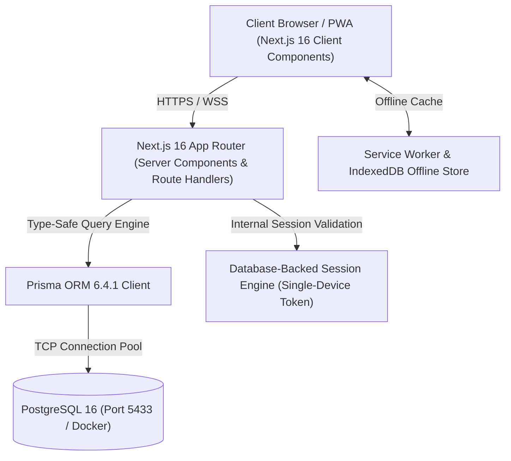
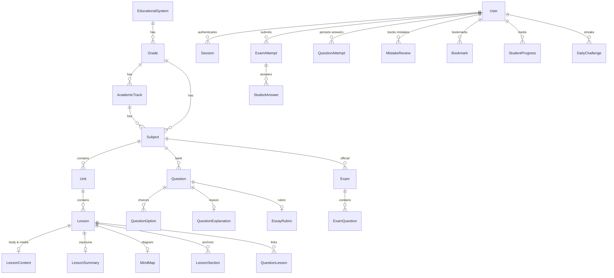
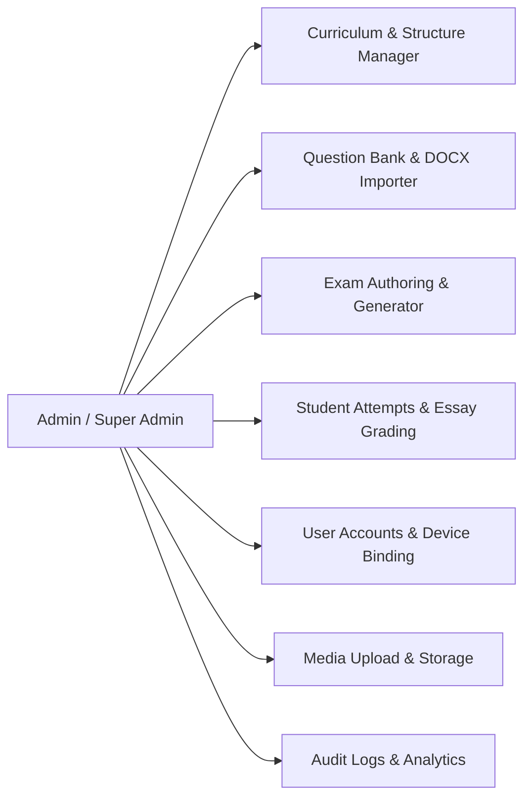
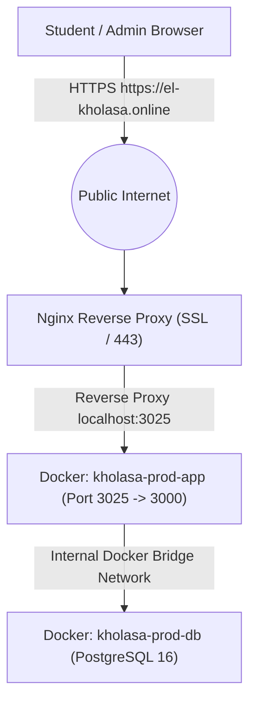

# منصة الخلاصة التعليمية الذكية | PLATFORM MASTER DOCUMENTATION
> **Document Version:** 2.1.0  
> **Last Updated:** November 2026  
> **Target Audience:** AI Agents, LLMs, System Architects, Senior Software Engineers  
> **Status:** Authoritative Source of Truth (Active Production Reference)

---

## 1. Executive Overview & Product Manifesto

### 1.1 Platform Identity & Core Mission
- **Name:** منصة «الخلاصة» التعليمية الذكية (EL KHOLASA)
- **Tagline:** *افهمها صح.. هتفضل معاك*
- **Domain:** Secondary Education (Thanaweya Amma, Al-Azhar, Language Schools, International/Equivalence Qualifications in Egypt).
- **Core Philosophy:** High-efficiency conceptual learning built on spaced repetition, active recall, cognitive chunking, and strict curriculum isolation.
- **Tone & Aesthetics:** Oxford-grade academic seriousness. Pure solid surfaces (Carbon/Zinc theme), zero cartoon emojis, zero casual animations, and zero fake engagement metrics.

### 1.2 Target User Personas
1. **Student (`STUDENT`):**
   - Enrolled in an educational system, grade, school category (`ARABIC` or `LANGUAGES`), and optional track (`SCIENCE`, `MATH`, `LITERATURE`).
   - Learns through a 4-tab lesson viewer, interactive flashcards, live translations, personalized mistake bank ("غلطاتي"), daily challenges, and custom-scoped adaptive exams.
2. **Teacher / Editor (`TEACHER` / `EDITOR`):**
   - Authors lessons, structures content, imports questions from Word (`.docx`), builds official exams, and reviews essay submissions.
3. **Admin / Super Admin (`ADMIN` / `SUPER_ADMIN`):**
   - Manages school systems, tracks, curriculum structures, user accounts, device bindings, audit trails, and announcements.

---

## 2. Technology Stack & Architectural Principles



### 2.1 Core Framework & Runtime
- **Framework:** Next.js 16.4.2 (App Router) + React 19.3.1.
- **Language:** TypeScript 5.x running in strict mode (`"strict": true`).
- **Database & ORM:** PostgreSQL 16 managed through Prisma ORM 6.4.1.
- **Styling Engine:** Tailwind CSS v4 (`@import "tailwindcss";`) with strict custom CSS variables.
- **Icons:** Phosphor Icons (`@phosphor-icons/react`) and Lucide React (`lucide-react`). **Zero unicode cartoon emojis permitted in UI components.**
- **Motion & Interaction:** Framer Motion 14 used strictly for micro-interactions (`.interactive-tap`, subtle fades). No heavy parallax, 3D tilts, or distracting banners.
- **Text & Bidirectionality:** Exclusively `IBM Plex Sans Arabic` with full RTL layout support and isolated LTR rendering for foreign/scientific terms via `BidiStatement`.
- **Packaging & Deployment:** Docker Compose containerized Next.js and PostgreSQL behind an Nginx reverse proxy with SSL terminating at `https://el-kholasa.online`.

---

## 3. Database Schema & Data Models (Prisma 6.4.1)

### 3.1 Entity Relationship Diagram



### 3.2 Enum Definitions

| Enum Name | Values | Purpose |
| :--- | :--- | :--- |
| `Role` | `STUDENT`, `TEACHER`, `EDITOR`, `ADMIN`, `SUPER_ADMIN` | RBAC role authorization |
| `QuestionType` | `MCQ`, `TRUE_FALSE`, `ESSAY` | Question formats |
| `Difficulty` | `EASY`, `MEDIUM`, `HARD` | Question cognitive complexity |
| `PublishStatus` | `DRAFT`, `IN_REVIEW`, `PUBLISHED`, `ARCHIVED` | Editorial workflow |
| `ExamMode` | `PRACTICE`, `EXAM` | Practice mode vs timed official exam |
| `SchoolCategory` | `ARABIC`, `LANGUAGES` | Strict curriculum separation boundary |
| `NotificationType` | `ANNOUNCEMENT`, `SYSTEM`, `DAILY_EXAM`, `MISTAKE_REMINDER`, `COURSE_UPDATE` | Dispatch classifications |

### 3.3 Core Models Description

#### 1. Identity & Access Management
- **`User`**: Core user record. Contains educational scope (`systemId`, `gradeId`, `trackId`, `schoolCategory`), device security (`maxDevices` default 1, `boundDevices: string[]`), role, and status.
- **`Session`**: Database-persisted session tokens (`sessionToken`, `userId`, `deviceId`, `expires`). Cookie-driven with `httpOnly`, `sameSite=lax`.
- **`Account`**: OAuth provider bindings (Google/Credentials).
- **`VerificationToken`**: Temporary OTP tokens for password reset and mobile authentication.

#### 2. Curriculum Hierarchy
- **`EducationalSystem`**: Highest container (e.g., الثانوية العامة, الأزهر الشريف, الدبلومة الأمريكية).
- **`Grade`**: Educational level (e.g., الصف الأول الثانوي, الصف الثالث الثانوي).
- **`AcademicTrack`**: Sub-specialization within a grade (e.g., علمي علوم, علمي رياضة, أدبي, عام). Can be track-neutral (`null`).
- **`Subject`**: Academic course. Bound to `systemId`, `gradeId`, `schoolCategory`, and optional `trackId`.
- **`Unit`**: Thematic grouping of lessons within a subject.
- **`Lesson`**: The atomic teaching unit. Contains duration, view count, and relations to content, summary, mindmap, and questions.
- **`LessonContent`**: Deep content of a lesson (Markdown/HTML body, videoUrl, audioUrl, pdfUrl, objectives).
- **`LessonSummary`**: High-yield "Zaytouna" revision card: key concepts, definitions, formulas, comparisons, exam tips, and common mistakes in structured JSON.
- **`MindMap`**: Visual conceptual diagrams (nodes, edges, structured JSON, images).
- **`LessonSection`**: Anchor sections inside a lesson for targeted question explanations.

#### 3. Assessment & Question Bank
- **`Question`**: The atomic assessment item. Bound to `subjectId`, optional `unitId`, `schoolCategory`, `type`, `difficulty`, `status`, optional `imageUrl`, and optional `translation` (Arabic/English counterpart).
- **`QuestionOption`**: Options for MCQ / True-False. Contains `text`, `translation`, `isCorrect`, `explanation`, and `order`.
- **`QuestionLesson`**: Many-to-many junction connecting a question to one or more lessons.
- **`QuestionExplanation`**: Pedagogical justification of the correct answer, linked optionally to a `LessonSection`.
- **`EssayRubric`**: Model answer and criteria breakdown with `maxScore` for subjective essay questions.
- **`ImportBatch`**: Metadata tracker for bulk-uploaded questions via DOCX parser.

#### 4. Exams & Attempts
- **`Exam`**: Exam configuration. Either official (`isCustom: false`) or student-generated (`isCustom: true`). Has `durationMinutes`, `schoolCategory`, and question relations.
- **`ExamQuestion`**: Ordered junction table between `Exam` and `Question`.
- **`ExamAttempt`**: Submission instance of an exam. Tracks `score`, `percentage`, `totalQuestions`, `timeSpentSeconds`, `isCompleted`, and completion timestamp.
- **`StudentAnswer`**: Answer record within an `ExamAttempt`. Records `selectedOptionId`, `essayText`, `isCorrect`, `score`, and `timeSpentSeconds`.
- **`QuestionAttempt`**: Global persistent record of a student's answer to any question across the platform. Enables immediate answer recovery upon reloading lessons or revisiting questions.

#### 5. Adaptive Learning & Retention
- **`MistakeReview`**: "ركن غلطاتي" (Mistake Bank). Tracks question mistakes (`wrongCount`), resolution state (`isResolved`), and timestamp of last attempt.
- **`StudentProgress`**: Tracks lesson completion percentage and last access timestamp.
- **`Bookmark`**: Student favorited questions or lessons (enforced mutual exclusivity: exactly one of `lessonId` or `questionId`).
- **`DailyChallenge`**: Daily 3-to-5 question check-in generated once per calendar day (Africa/Cairo timezone). Tracks streak continuity.

#### 6. Governance & Notifications
- **`AuditLog`**: Immutable security log tracking admin operations (`action`, `resource`, `resourceId`, `details`, `userId`).
- **`Announcement`**: Broadcast announcements targeted by `targetGradeId` and `targetSchoolCategory`.
- **`NotificationRead`**: Tracks announcement reads per user.
- **`PushSubscription`**: Web Push API subscriptions (VAPID endpoint, p256dh, auth keys).

---

## 4. Curriculum Isolation & Scoping Engine

The system strictly isolates educational content. Students must never be exposed to questions, exams, or subjects from outside their grade, school category, or academic track.

### 4.1 Hierarchy Tree
```
EducationalSystem
 └── Grade (e.g. 3rd Secondary)
      ├── SchoolCategory: ARABIC (مدارس عربي)
      │    ├── Track: SCIENCE (علمي علوم) -> Biology, Chemistry, Physics (Arabic)
      │    ├── Track: MATH (علمي رياضة)   -> Pure Math, Applied Math, Physics (Arabic)
      │    └── Track: LITERATURE (أدبي)   -> History, Geography, Philosophy (Arabic)
      └── SchoolCategory: LANGUAGES (مدارس لغات)
           ├── Track: SCIENCE (علمي علوم) -> Biology, Chemistry, Physics (English)
           ├── Track: MATH (علمي رياضة)   -> Pure Math, Mechanics, Physics (English)
           └── Track: LITERATURE (أدبي)   -> History, Geography, Philosophy (Arabic/English)
```

### 4.2 Scoping Functions (`src/lib/curriculum.ts`)
1. **`getCurriculumScope(user)`**:
   Extracts `systemId`, `gradeId`, `schoolCategory` (defaults to `"ARABIC"`), and `trackId` from authenticated student. Non-students (admins, teachers) return `null` (unrestricted scope).
2. **`subjectScopeWhere(scope)`**:
   Prisma filter ensuring:
   - `gradeId == scope.gradeId`
   - `schoolCategory == scope.schoolCategory`
   - `systemId == scope.systemId`
   - `trackId == null OR trackId == scope.trackId` (Track-neutral subjects like Arabic or Religion are visible to all tracks; specialized subjects only to matching track).
3. **`questionScopeWhere(scope)`**:
   Constrains question queries by filtering on `schoolCategory` and matching `subject: { is: subjectScopeWhere(scope) }`.
4. **`examScopeWhere(scope)`**:
   Constrains official exams by `isCustom: false`, `schoolCategory`, and scoped subjects.
5. **`isSubjectInScope(scope, subject)`**:
   Runtime boolean predicate verifying that a given subject object strictly belongs to the student's scope.

---

## 5. Authentication, Authorization & Security Architecture

### 5.1 Custom Database Session Engine
- Unlike standard NextAuth or stateless JWTs, sessions are stored in the PostgreSQL `Session` table.
- Cookies: `session_token` stored as `httpOnly`, `sameSite=lax`, `secure` (in production), with a 30-day expiration window.
- **Session Validation (`src/lib/auth.ts`):** Every API request and server component calls `getCurrentUser()` or `requireAuth()`, which joins `Session` -> `User`, verifies active status, and binds educational scope.

### 5.2 Single-Device Binding
- Each student account is locked to a single physical device (`maxDevices = 1`) by default to prevent credential sharing.
- `User.boundDevices: string[]` stores sha256 hashes of client fingerprints.
- When an account logs in from an unregistered device beyond `maxDevices`, the authentication route throws HTTP 403 (`DEVICE_LIMIT_REACHED`).
- Admins can reset device bindings via `POST /api/admin/users/[id]/reset-devices`.

### 5.3 Password Cryptography
- Passwords are hashed using `bcryptjs` with salt rounds = 12.
- Password change (`POST /api/auth/change-password`) enforces current password verification and immediately invalidates all other active sessions for that user ID.

### 5.4 Rate Limiting & DoS Protection
- Implemented in `src/lib/rate-limit.ts` using token bucket algorithm in memory.
- Keyed on client IP (`x-real-ip` or `x-forwarded-for`).
- High-risk endpoints (login, register, OTP send) enforce strict request caps (e.g. 5 attempts per 15 minutes).

### 5.5 Content Protection & Anti-Theft Policy (DEC-013)
- Media players (`video`, `audio`) enforce `controlsList="nodownload"`, `disablePictureInPicture`, and `onContextMenu={(e) => e.preventDefault()}`.
- Mind maps and Zaytouna summary images have right-click saving and dragging disabled.
- Direct PDF downloads for lesson notes are restricted to verified authenticated channels.

---

## 6. Student Experience & Core Features

### 6.1 The 4-Tab Lesson Viewer (`/lessons/[id]`)
Each lesson is decomposed into four distinct cognitive dimensions:
1. **الشرح والوسائط (Explanation & Media):**
   - Rich Markdown content rendered with typography hierarchy.
   - Streaming video player and audio podcast player.
   - Lesson objectives and interactive progress checklist.
2. **الخريطة الذهنية (Interactive Mind Map):**
   - High-resolution SVG / Canvas mental schema.
   - Pan, zoom, and fullscreen controls without external distractions.
3. **المصطلحات والتسميع (Flashcards & Active Recall):**
   - 3D flip card component with smooth CSS transforms.
   - Multi-paragraph and numbered definitions rendered cleanly via `FormattedDefinitionView`.
   - Self-evaluation actions:
     - **"تمام" (Mastered):** Advances card, marks term as understood.
     - **"مش تمام" (Struggling):** Automatically dispatches `POST /api/lessons/[id]/flashcards/mistake`, logging the term directly into the student's Mistake Bank for spaced review.
4. **أسئلة الدرس (Lesson Questions & Practice):**
   - Instant in-lesson question practice.
   - Instant answer verification with pedagogical explanation breakdown.
   - Automatic background persistence (`QuestionAttempt`).

### 6.2 Lesson Mistake Drill ("كبسولة التدريب السريع على نقاط الضعف")
- Accessed directly from `LessonHeader.tsx` via the button "كبسولة نقاط الضعف".
- Opens `LessonMistakesCapsuleModal.tsx`, fetching all active mistakes recorded for this specific lesson.
- Interactive question-by-question drill.
- Upon answering a mistake correctly, `isResolved: true` is sent to the backend, removing it from the student's active mistake burden.
- Designed with clean Phosphor SVGs (`ArrowClockwise`, `CheckCircle`, `WarningCircle`), completely free of cartoon emojis.

### 6.3 Universal Question Persistence (`QuestionAttempt`) & Automated Mistake Resolution
- **Continuous Answer Logging:** Every time a student selects an answer or submits an essay anywhere on the platform (in a lesson via `/api/questions/[id]/answer` or an exam via `/api/exams/[id]/submit`), the response is permanently recorded in `QuestionAttempt`.
- **Pre-population on Return:** When a student opens any lesson, their previously chosen choices, correctness state, and essay answers are pre-populated directly from `QuestionAttempt`.
- **Automated Mistake Auto-Resolution:** In accordance with cognitive mastery principles, whenever a student correctly answers a question in an exam (whether through custom exam, lesson exam, or unit exam), `ExamAttemptService.submitExamAttempt` executes an ACID transaction:
  - Updates `ExamAttempt` (`isCompleted: true`, score, and percentage).
  - Syncs the answer to `QuestionAttempt` (`isCorrect: true`).
  - Automatically resolves any corresponding active record in `MistakeReview` (`isResolved: true`), immediately clearing the burden from "ركن غلطاتي" and the lesson's weak-spot capsule.
  - Symmetrically, any newly failed questions are upserted into `MistakeReview` (`isResolved: false`, `wrongCount` incremented).
  - Synchronized across both the direct client answers payload path and incremental `recordAnswer` execution path.

### 6.4 Spaced Learning & Smart Custom Exam Builder (`/exams/builder`)
- Students can construct custom exams targeting:
  - An entire Subject.
  - A specific Unit.
  - A single Lesson.
- **Adaptive Question De-duplication:**
  - The exam generator queries all questions matching the chosen scope.
  - It cross-references `QuestionAttempt` where `userId = student.id` and `isCorrect = true`.
  - Mastered questions are **completely excluded** from new exams until the student has exhausted 100% of the questions in that bank.
  - Displays dynamic indicators: `unmasteredCount` (الأسئلة الجديدة / التي لم تُتقن) vs `masteredCount` (الأسئلة المتقنة سابقاً).
  - **Medium Difficulty Fallback:** If a student selects Medium difficulty but the bank has zero Medium questions, the engine intelligently draws a balanced progression of Easy and Hard questions, and calculates accurate builder stats via `isMediumFallback`.
- Dynamic naming: Automatically names generated exams (e.g. `امتحان درس: الحركة في اتجاه واحد`, `امتحان وحدة: القوى والحركة`).

### 6.5 Full Exam History & Inspection (`/exams`)
- All historical exam attempts (official exams, unit exams, lesson exams, custom generator exams) are stored permanently in `ExamAttempt`.
- Displayed in `StudentExamHistoryList.tsx` with filter tabs:
  - **الكل (All)**
  - **امتحانات الدروس (Lesson Exams)**
  - **امتحانات الوحدات (Unit Exams)**
  - **شاملة ومخصصة (Comprehensive & Custom)**
- Students can click "مراجعة الإجابات" on any completed attempt to open `/exams/[id]/results`, reviewing their answers, correct answers, time spent, and detailed explanations.

### 6.6 100% Dynamic Content & Zero-Static Metric Policy
- To maintain complete data integrity, all metrics, counters, and statistics across the platform are strictly computed from live PostgreSQL queries.
- **Landing Page (`/`):** The subjects showcase queries live subjects with `_count: { units: true, questions: true }` and displays real available curriculum counts.
- **Subjects Explorer (`/subjects`):** Aggregates exact questions and units filtered strictly by the authenticated student's `questionScopeWhere(scope)` and `subjectScopeWhere(scope)`.
- Zero placeholder mock strings (e.g. arbitrary `+3,200 سؤال`, hardcoded `92%`, or static `إتقان 100%`) are permitted in the application code.

### 6.6 On-Demand Live Translation Engine
- Specifically built for Language Schools (`LANGUAGES` category), where STEM subjects are taught in English.
- Every question, option, and essay model answer supports optional `translation` fields.
- Students can toggle between English and Arabic using the inline translation button (`Globe` / `Translate` icon).
- When toggled, the direction switches seamlessly:
  - English: `dir="ltr"` with left-aligned Latin typography.
  - Arabic: `dir="rtl"` with right-aligned `IBM Plex Sans Arabic`.
- **Anti-Leak Invariant:** Translation toggling only translates text; it never reveals correct options or alters the state of the question.

### 6.7 Daily Challenge & Entrance Gatekeeper
- Triggered on the student dashboard `/dashboard`.
- Each Cairo calendar day (Africa/Cairo timezone calculated via `src/lib/date.ts`), the system issues a 3-question challenge.
- Maintains continuous day streaks (`DailyChallenge.completedAt`).
- Integrated into `EntranceGatekeeperModal.tsx` for students who haven't completed their daily check-in.

### 6.8 Smart Student Mastery Map & Score Progression (`StudentMasteryMapCard.tsx`)
- Calculates real question mastery percentage per subject, unit, and lesson based on `QuestionAttempt.isCorrect = true`.
- Dynamic Mastery Badges:
  - $\ge 80\%$: "متقن بامتياز" (Emerald Green)
  - $50\% - 79\%$: "مستوى جيد — يحتاج مراجعة" (Amber)
  - $< 50\%$: "بحاجة لتركيز" (Muted Slate / Red)
- **Progression Sparkline (رسم بياني لتطور الدرجات):**
  - Pure SVG responsive line & shaded area chart showing the trajectory of the student's last 10 completed exams.
  - Date and percentage markers with positive/negative delta tracking.
- **Actionable Focus Recommendation:**
  - Automatically identifies the lesson with the most unresolved mistakes or lowest mastery score.
  - Direct 1-click CTA launching an adaptive exam or lesson study session.

### 6.9 Full PWA Offline Mode & Offline Study Center (`/offline`)
- Client-side storage engine using IndexedDB (`src/lib/offline-db.ts`).
- Lesson saving toggle inside `LessonHeader.tsx`: 1-click downloads lesson body, golden summary, definitions, formulas, and mind map into local storage.
- Interactive Offline Study Center at `/offline`:
  - Lists all locally cached lessons grouped by subject.
  - Full-screen `OfflineLessonViewerModal` providing 100% network-independent reading, definitions flashcards, and formulas.
  - Live online/offline detection with auto-refresh and cache deletion controls.

---

## 7. Backoffice & Admin Subsystems (`/admin`)



### 7.1 Curriculum Management (`/admin/curriculum` & `/admin/structure`)
- Full hierarchical CRUD:
  - Create/edit Educational Systems and Grades.
  - Create/edit Academic Tracks with category scoping.
  - Create/edit Subjects with `schoolCategory` specification (`ARABIC` vs `LANGUAGES`).
  - Create/edit Units and Lessons.
  - Rich lesson editor (`/admin/curriculum/lessons/[id]`): Edit body content, embed video/audio URLs, configure Zaytouna summaries, and design mind map nodes.

### 7.2 Smart DOCX Question Bank & Bulk Import (`/admin/questions/import`)
- Upload Microsoft Word (`.docx`) files.
- Uses `mammoth` to extract clean raw text while preserving formatting.
- Parses questions, multiple choices, correct answers marked with asterisks (`*`) or symbols, explanations, difficulties, and English translations using regex rules (`src/lib/question-parser.ts`).
- Records batch metadata in `ImportBatch`.

### 7.3 Student Attempts & Essay Manual Grading (`/admin/attempts`)
- Lists all student exam attempts across the platform with filtering by subject, user, and completion status.
- **Essay Grading Engine:**
  - Displays student's written `essayText` side-by-side with `EssayRubric.modelAnswer`.
  - Admin awards scores from 0 to `rubric.maxScore`.
  - Recalculates total attempt score and percentage transactionally.

### 7.4 User & Device Binding Management (`/admin/users`)
- View and search users by name, phone, role, grade, and school category.
- Toggle account activation state (`isActive`).
- Reset device bindings: Clears `User.boundDevices`, allowing the student to register a new device after hardware changes.
- Change user roles (`STUDENT`, `TEACHER`, `EDITOR`, `ADMIN`, `SUPER_ADMIN`) with protection against self-demotion or Super Admin tampering.

### 7.5 Media Management & Protection (`/admin/media`)
- Upload images, audio clips, and documents.
- Stores files in `uploads/` directory on disk.
- Serves protected media through `/api/media/[...path]` with session authentication checks.

---

## 8. Complete API Route Catalog

| Route Path | HTTP Methods | Required Role | Description & Side Effects |
| :--- | :--- | :--- | :--- |
| `/api/auth/login` | `POST` | Public | Authenticates credentials, verifies device binding, sets `session_token` cookie. |
| `/api/auth/register` | `POST` | Public | Creates student user, assigns curriculum scope, registers device fingerprint. |
| `/api/auth/logout` | `POST` | Authenticated | Deletes database session, clears cookie. |
| `/api/auth/me` | `GET` | Authenticated | Returns current user profile, role, and curriculum scope. |
| `/api/auth/change-password` | `POST` | Authenticated | Verifies old password, updates bcrypt hash, invalidates all other sessions. |
| `/api/auth/otp/send` | `POST` | Public | Generates and sends OTP code for password reset. |
| `/api/auth/otp/verify` | `POST` | Public | Verifies OTP code, returns reset token. |
| `/api/auth/reset-password` | `POST` | Public | Resets password using verified token. |
| `/api/admin/structure` | `GET`, `POST` | `ADMIN`+ | Lists or creates Educational Systems, Grades, and Tracks. |
| `/api/admin/curriculum/toggle` | `POST` | `EDITOR`+ | Toggles publish status of subject, unit, or lesson. |
| `/api/admin/curriculum/bulk-import` | `POST` | `ADMIN`+ | Bulk creates curriculum nodes from JSON. |
| `/api/admin/units` | `GET`, `POST` | `EDITOR`+ | Lists or creates units for a subject. |
| `/api/admin/units/[id]` | `PATCH`, `DELETE` | `EDITOR`+ | Modifies or deletes a unit. |
| `/api/admin/lessons` | `GET`, `POST` | `EDITOR`+ | Lists or creates lessons for a unit. |
| `/api/admin/lessons/[id]` | `GET`, `PATCH`, `DELETE`| `EDITOR`+ | Gets full lesson details, updates content, or deletes lesson. |
| `/api/admin/lessons/[id]/questions` | `GET`, `POST` | `EDITOR`+ | Manages question associations for a lesson. |
| `/api/admin/questions` | `GET`, `POST` | `EDITOR`+ | Queries question bank with filters, or creates a single question. |
| `/api/admin/questions/[id]` | `GET`, `PATCH`, `DELETE`| `EDITOR`+ | Modifies or archives a specific question. |
| `/api/admin/questions/bulk` | `POST` | `EDITOR`+ | Bulk status change or bulk deletion of questions. |
| `/api/admin/questions/parse-docx` | `POST` | `EDITOR`+ | Extracts questions from uploaded `.docx` file using mammoth. |
| `/api/admin/questions/cleanup` | `POST` | `SUPER_ADMIN` | Purges orphaned or duplicate questions. |
| `/api/admin/exams` | `GET`, `POST` | `TEACHER`+ | Lists official exams or creates an official exam. |
| `/api/admin/exams/[id]` | `GET`, `PATCH`, `DELETE`| `TEACHER`+ | Inspects, modifies, or deletes an official exam. |
| `/api/admin/attempts` | `GET`, `PATCH` | `TEACHER`+ | Lists student exam attempts or grades essay questions. |
| `/api/admin/users` | `GET`, `POST` | `ADMIN`+ | Lists users with search/pagination, or creates staff accounts. |
| `/api/admin/users/[id]` | `GET`, `PATCH`, `DELETE`| `ADMIN`+ | Updates user details or archives user. |
| `/api/admin/users/[id]/toggle-status`| `POST` | `ADMIN`+ | Activates/deactivates a user account. |
| `/api/admin/users/[id]/reset-devices`| `POST` | `ADMIN`+ | Flushes `boundDevices` array for a user. |
| `/api/admin/upload` | `POST` | `EDITOR`+ | Uploads media files to disk storage. |
| `/api/admin/analytics` | `GET` | `ADMIN`+ | Aggregates system metrics, attempts count, active users. |
| `/api/admin/notifications` | `GET`, `POST` | `ADMIN`+ | Dispatches target-scoped announcements. |
| `/api/questions/[id]/answer` | `POST` | `STUDENT` | Upserts `QuestionAttempt`, persisting student answer immediately. |
| `/api/lessons/[id]/progress` | `POST` | `STUDENT` | Updates lesson completion percentage in `StudentProgress`. |
| `/api/lessons/[id]/flashcards/mistake`| `POST`| `STUDENT` | Logs a flashcard mistake into `MistakeReview`. |
| `/api/lessons/[id]/offline` | `GET` | `STUDENT` | Returns full JSON payload of a lesson for IndexedDB caching. |
| `/api/exams/create` | `POST` | `STUDENT` | Creates a custom exam (subject/unit/lesson) excluding mastered questions. |
| `/api/exams/builder/stats` | `GET` | `STUDENT` | Returns total questions, mastered count, and unmastered count for a scope. |
| `/api/exams/[id]/submit` | `POST` | `STUDENT` | Submits exam attempt, computes score, logs mistakes into `MistakeReview`. |
| `/api/student/daily-checkin` | `GET` | `STUDENT` | Fetches or creates today's DailyChallenge for the student. |
| `/api/student/daily-checkin/quick` | `GET` | `STUDENT` | Lightweight check if today's challenge is completed. |
| `/api/student/daily-checkin/submit` | `POST` | `STUDENT` | Submits daily challenge answers and advances streak counter. |
| `/api/bookmarks` | `GET`, `POST`, `DELETE`| `STUDENT` | Manages student bookmarks for lessons or questions. |
| `/api/notifications` | `GET` | Authenticated | Fetches announcements matching student's grade/category. |
| `/api/notifications/push` | `POST` | Authenticated | Saves Web Push subscription endpoint. |
| `/api/search` | `GET` | Authenticated | Global curriculum search scoped to student's grade. |
| `/api/media/[...path]` | `GET` | Authenticated | Streams protected media files with session validation. |

---

## 9. UI Design System, Design Tokens & Components

### 9.1 Color Token Matrix
All styles are defined in `src/app/globals.css` with explicit hex tokens. Standard Tailwind color classes (e.g., `bg-blue-500`, `text-emerald-400`) are banned in favor of theme semantic tokens.

| Token | Light Mode Hex | Dark Mode Hex | Usage |
| :--- | :--- | :--- | :--- |
| `--primary` | `#4F46E5` | `#6366F1` | Primary CTA buttons, active state highlights |
| `--foreground` | `#0F172A` | `#F8FAFC` | Main headings, body text |
| `--muted-foreground` | `#64748B` | `#94A3B8` | Subheadings, metadata, captions |
| `--background` | `#FFFFFF` | `#0F172A` | Global page background |
| `--surface` | `#F8FAFC` | `#1E293B` | Cards, modals, elevated panels |
| `--border` | `#E2E8F0` | `#334155` | Structural borders, dividers |
| `--success` | `#059669` | `#34D399` | Correct answers, mastered badges |
| `--warning` | `#D97706` | `#FBBF24` | Review reminders, streak badges |
| `--destructive` | `#DC2626` | `#F87171` | Wrong answers, error messages, delete actions |

### 9.2 Typography & Formatting Invariants
- **Font:** Exclusively `IBM Plex Sans Arabic` (`--font-ibm-plex-arabic`).
- **Heading Constraints:** Mobile titles max 28px; Desktop titles max 36px.
- **Minimum Legible Text:** 13px for captions/metadata.
- **Border Radius Standards:**
  - Interactive Buttons: `8px` (`rounded-lg`)
  - Cards & Panels: `12px` (`rounded-xl`)
  - Dialogs & Modals: `16px` (`rounded-2xl`)
- **Touch Target Requirement:** All buttons, toggles, and cards must maintain a minimum bounding box of `44px x 44px` on mobile viewports.

### 9.3 Bi-Directional Isolation (`BidiStatement`)
- When rendering scientific expressions, English terminology, chemical formulas, or programming code within Arabic text, direct browser RTL rendering distorts punctuation and reverses parenthesis.
- Component [`BidiStatement`](src/components/ui/BidiStatement.tsx) dynamically splits text by regex, wrapping Latin segments in `<bdi dir="ltr">` to guarantee 100% typographic fidelity.

---

## 10. Deployment & Infrastructure Architecture



### 10.1 Production Specifications
- **Host Server IP:** `72.62.27.196` (Ubuntu Linux VPS)
- **Base Directory:** `/var/www/el-kholasa`
- **Domain:** `https://el-kholasa.online`
- **Reverse Proxy:** Nginx with Let's Encrypt SSL/TLS certificates.
- **Process Orchestration:** Docker Compose (`docker-compose.prod.yml`).
  - Container `kholasa-prod-app`: Node.js 20 alpine running Next.js standalone server on port 3025 (mapped to internal 3000).
  - Container `kholasa-prod-db`: PostgreSQL 16 on internal network with persistent data volume `db_data`.

### 10.2 Deployment Pipeline & Commands
To deploy updates to the production server:
```bash
# 1. SSH into the production host
ssh -i ~/.ssh/kholasa_vps root@72.62.27.196

# 2. Navigate to project root
cd /var/www/el-kholasa

# 3. Pull latest commit from production branch
git pull origin fix/audit-remediation

# 4. Rebuild the application image
docker compose -f docker-compose.prod.yml build app

# 5. Recreate container with zero data loss
docker compose -f docker-compose.prod.yml up -d --force-recreate app

# 6. Apply database schema migrations if any
docker compose -f docker-compose.prod.yml exec app npx prisma migrate deploy

# 7. Verify health
curl -I https://el-kholasa.online
```

---

## 11. AI Agent Operational Rules & Invariants

Whenever an AI agent, LLM, or software engineer interacts with this codebase, the following **Ten Commandments** MUST be strictly enforced:

1. **Never Violate Curriculum Scoping:**  
   Never query `Subject`, `Question`, or `Exam` without filtering through `subjectScopeWhere(scope)` or `questionScopeWhere(scope)`. Students must never see content outside their `gradeId` or `schoolCategory`.
2. **Never Use Cartoon Emojis:**  
   Never introduce emojis (e.g. `⚡`, `👏`, `💡`, `👍`, `🌟`, `🎉`, `💪`, `📌`) in any user-facing code. Always use Phosphor Icons or Lucide React with semantic color classes.
3. **Never Hardcode Secrets or Credentials:**  
   Never place database URLs, JWT secrets, or API keys in code files. All configuration must resolve via `process.env`.
4. **Never Bypass Single-Device Session Validation:**  
   Never disable device check in `src/app/api/auth/login/route.ts` or `src/lib/auth.ts`.
5. **Never Execute Destructive Database Reseeds in Production:**  
   Never run `prisma db push --force-reset` or `prisma migrate reset` on production databases.
6. **Preserve Bidirectional Text Rendering:**  
   Always wrap dynamic mixed Arabic/English text in `BidiStatement` to prevent layout collapse.
7. **Maintain Strict TypeScript Typing:**  
   Never use `any` unless strictly necessary for third-party boundary parsing. Run `npx tsc --noEmit` before proposing changes.
8. **Honor Single Source of Truth for Design Tokens:**  
   Always use semantic classes (`bg-surface`, `text-primary`, `border-border`, etc.) instead of arbitrary palette names.
9. **Persist User Answers Universally:**  
   Every new interactive learning activity or exam widget must hook into `QuestionAttempt` to persist student progress across sessions.
10. **Verify Before Declaring Success:**  
    Always execute type checks (`npx tsc --noEmit`) and build checks (`npm run build`) before declaring an implementation complete.

---
*End of Master Platform Documentation — EL KHOLASA*

